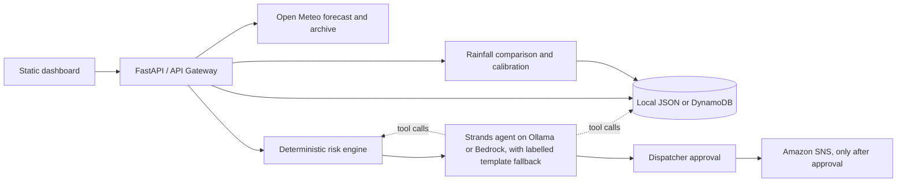

# Underpass Sentinel

An AI assisted decision support prototype for transport coordinators assessing rainfall related waterlogging risk at 26 candidate low points across Delhi. It is designed for a dispatcher to review before any warning is distributed. It is **not** a certified flood prediction or emergency response system.

Built for Environmental Hacks (WeMakeDevs with AWS), **Heat and Water** track, on the **Build It** path: the proposal is drafted by an agent built with the open-source [Strands Agents SDK](https://strandsagents.com) from AWS, running on a local Ollama model. No AWS account is needed to run it. The same code can be deployed to AWS with the included SAM template.

## The problem

Every monsoon, the same Delhi underpasses fill with water after a short, intense burst of rain. School buses, ambulances and delivery fleets are routed into them because the person dispatching vehicles has a city-wide rain forecast, not a per-underpass answer. Underpass Sentinel turns the hourly forecast into a per-location risk level, has an agent draft the warning, and keeps a human in charge of sending it.

## Intended users and workflow

School transport coordinators, ambulance dispatchers, fleet operators, and other transport coordinators can use the six step workflow:

1. **Forecast:** request hourly precipitation from Open Meteo, or choose a clearly labelled historical Replay.
2. **Assess:** deterministic backend code compares the peak hourly precipitation with the current estimated threshold.
3. **Propose:** a Strands agent reads the computed results through tools, checks how past alerts for each flagged spot compared with observed rainfall, and drafts the briefing and one action per spot. Numbers, risk levels and the Hindi text always come from the deterministic engine. If the model is unavailable or its reply is unusable, a deterministic template is used and labelled as a fallback.
4. **Approve:** a dispatcher explicitly approves or rejects the proposal.
5. **Act:** approved text is sent to SNS when configured; local mode records `local-skipped` and sends nothing.
6. **Verify:** archived rainfall is compared with the forecast and may adjust estimated thresholds. This verifies rainfall comparisons only, not flooding.



## Risk calculation and source limits

For each location, the backend takes the maximum usable hourly precipitation in the assessment window, then computes `peak mm/hr ÷ threshold mm/hr`. A ratio below 0.6 is GREEN, 0.6 through less than 1.0 is AMBER, and 1.0 or above is RED. Missing, malformed, non-finite, and negative inputs are excluded; if no usable values remain, the spot is marked unavailable. Rainfall intensity is a proxy for potential waterlogging, not a measurement of standing water or a confirmed flood.

The inputs in [`data/spots.json`](data/spots.json) are 26 **unverified candidate coordinates and estimated thresholds**. Every location has `verified: false`; thresholds are demonstration inputs between 10 and 22 mm/hr and are not official values. Coordinates and thresholds require independent field and engineering verification. Mutable calibration values are stored separately from those original inputs.

All precipitation values are in millimetres per hour. The official [Historical Forecast API](https://open-meteo.com/en/docs/historical-forecast-api) documents historical forecast coverage starting around 2021, with model coverage varying by date; its endpoint is `/v1/forecast` on the `historical-forecast-api.open-meteo.com` host. The official [Historical Weather API](https://open-meteo.com/en/docs/historical-weather-api) documents `/v1/archive`, ISO date parameters, timezone handling, and precipitation as the preceding-hour sum in mm. Times returned by Open Meteo use `Asia/Kolkata` local time. Live mode includes the current local hour, floored to the hour, plus the next 11 hourly timestamps (12 inclusive); precipitation at each timestamp is the provider's preceding-hour sum. Replay uses 00:00 through 11:00 inclusive on the selected date. Replay requests the Historical Forecast API for forecast precipitation and Archive API for observed precipitation. If historical forecast data is unavailable but archive data exists, the archive is labelled as a **forecast demonstration fallback**; it is not represented as the forecast a dispatcher would have seen at the time. Archive observations remain a separate series for verification. If providers return no usable rainfall, the interface offers a separate synthetic fixture, clearly labelled; it is never presented as live or historical weather.

Every threshold adjustment uses a rainfall classification: flagged plus observed peak at least 0.6x threshold is `true_alarm`; flagged below 0.6x is `false_alarm`; unflagged at or above threshold is `missed_event`. A false alarm raises the threshold by 5%; a missed event lowers it by 10%; changes are clamped to 0.5x–2x the original. `no_data` remains pending. No flood observations or flood ground truth are included in this prototype.

## Services and deployment architecture

- **FastAPI / Mangum:** JSON endpoints and Lambda adapter. `/api/health` gives safe readiness indicators. `/docs` provides OpenAPI documentation.
- **Open Meteo:** public live forecast, historical forecast, and archived precipitation endpoints; no API key is required. Requests are bounded by timeouts and location concurrency limits.
- **Strands Agents SDK (AWS open source):** [`backend/app/services/agent.py`](backend/app/services/agent.py) defines the briefing agent and its two tools, `get_flagged_spots` and `get_calibration_history`. The agent writes prose only; the backend copies every number, risk level, spot id and timestamp from the computed assessment and validates the result. Each proposal stores an `agent_trace` (framework, provider, model, tools called) that the dashboard shows. A reply the agent wrote without reading the assessment is rejected. Failures produce `generated_by: fallback` plus a reason.
- **Model provider:** `AGENT_PROVIDER=ollama` (default) uses a local Ollama model set by `OLLAMA_MODEL_ID`. `AGENT_PROVIDER=bedrock` uses Amazon Bedrock through the same Strands agent, with `BEDROCK_MODEL_ID` and `BEDROCK_REGION`; model access varies by account and region. The SAM template deploys the Lambda with `AGENT_PROVIDER=bedrock`.
- **Amazon DynamoDB:** proposals, independently calibrated thresholds, and verification history when `USE_DYNAMODB=true`. Local mode stores JSON under `.local_data/` and survives restarts. A configured DynamoDB permission or setup error fails clearly; it does not switch to local mode.
- **Amazon SNS:** sends the bilingual alert only after dispatcher approval. Without `SNS_TOPIC_ARN`, approval is recorded as `local-skipped`. Email subscription requires recipient confirmation by SNS before delivery.
- **API Gateway HTTP API / SAM:** publishes the Lambda API with CORS origins configured as an exact list. CORS is not an authentication mechanism; deploy this decision support prototype only within an appropriate access-controlled environment.
- **Amplify Hosting:** serves a reproducible static ZIP created by `scripts/package_frontend.sh`. Leaflet and CARTO tiles, Google Fonts, and the map tiles are external browser dependencies and require network availability and attribution.

## Local setup

Requires Python 3.12 or newer (the SAM Lambda runtime is Python 3.12) and a network connection for live or historical Open Meteo data. Nothing in local mode requires AWS credentials. For agent-drafted proposals, install [Ollama](https://ollama.com), start it, and pull a tool-capable model (`ollama pull qwen3-vl:2b-instruct`, or set `OLLAMA_MODEL_ID` to one you have). Without Ollama the app still works and labels proposals as template fallback.

```sh
python -m venv .venv
# Linux/macOS:
. .venv/bin/activate
# Windows PowerShell: .venv\Scripts\Activate.ps1
python -m pip install -r backend/requirements.txt
cp .env.example .env
python -m uvicorn backend.app.main:app --host 127.0.0.1 --port 8000
```

Open <http://127.0.0.1:8000>. If port 8000 is in use, pick another port and set `CORS_ORIGINS` to match. The backend also serves the static dashboard, so requests use the same origin. Choose Replay and a past date, run an assessment, review the source badge and proposal, then approve or reject. Without SNS, the delivery result must say `local-skipped`. Historical rainfall can be verified after a Replay. Review the History tab for source, threshold changes, and rainfall-only caveats. If Open Meteo cannot provide values, the separate synthetic option proves the assessment/proposal/approval workflow. Synthetic forecasts cannot be verified or used for threshold calibration; use a historical forecast assessment instead.

For shell-based startup on Linux/macOS/Git Bash, use `sh scripts/run_local.sh`. API docs are at <http://127.0.0.1:8000/docs>; health is at <http://127.0.0.1:8000/api/health>.

## Tests

Run `python -m pytest -q`. Tests cover agent reply parsing and fallback, risk boundaries and invalid values, calibration bounds and outcome classification, proposal consistency, candidate inputs, API input validation, local persistence across storage recreation, and approval/rejection with local skipped delivery. External services are stubbed for the test suite; passing tests do not prove Ollama, AWS, Bedrock, SNS, or Open Meteo availability.

**Execution in this workspace (2026-10-11):** 25 tests passed, 0 failed. Against a live local server, a real Replay for 2023-07-09 returned historical forecast rainfall for all 26 candidate spots and flagged 14 as amber. The Strands agent (Ollama, `qwen3-vl:2b-instruct`) called `get_flagged_spots` and `get_calibration_history` and drafted the proposal. Approval was recorded as `local-skipped` because no SNS topic was configured, and rainfall verification wrote history records. Route check returned live OSRM alternatives and scored them against the flagged spots. The dashboard was checked with a headless Chrome screenshot at 1440 px. Not run here: `sam build`, any AWS deployment, the Bedrock provider (the local AWS credentials were rejected), and a phone-width check.

## AWS SAM deployment

1. Install AWS SAM CLI and configure AWS credentials for the target account.
2. Check the model identifier and region against the model access available to your account. Request/enable access to Amazon Nova Lite in that Bedrock region, then set `BedrockModelId` and `BedrockRegion` during deploy. The default model identifier may not be available in every region/account.
3. Build and deploy from the repository root:

   ```sh
   sam build
   sam deploy --guided
   ```

4. Set `FrontendOrigins` to the exact Amplify website origin (scheme and host, no path) so API Gateway CORS permits that browser origin.
5. Copy the `ApiUrl` stack output into `frontend/config.js` as `apiBaseUrl` (for example `https://…execute-api.…amazonaws.com`). Rebuild the static archive after editing.
6. Run `sh scripts/package_frontend.sh`; upload `dist/underpass-sentinel-frontend.zip` using Amplify Hosting's manual deployment flow.
7. The stack creates an SNS topic. Subscribe an email with the dashboard or SNS console and click the confirmation link sent to that mailbox. An unconfirmed subscription will not receive notifications.
8. Review Lambda role permissions, model availability, API CORS, and the deployed `/api/health` response. A successful SAM build is not an AWS deployment or integration test.

The frontend contains no AWS credentials. Do not put credentials in `frontend/config.js`.

## Route check

The **Route check** tab answers the question a dispatcher actually has: can I send this vehicle now? Pick an origin and destination (hospitals, stations, bus terminals, campuses). The backend asks the public OSRM service (OpenStreetMap data) for driving alternatives, measures how close each route passes to every flagged low point, and scores it (red 10, amber 3, within 300 m). The dashboard draws the routes, suggests the lowest-risk one, and says plainly when every route passes a flagged spot. "Clear of flagged spots" is not a claim that a road is dry. Code: [`backend/app/services/routing.py`](backend/app/services/routing.py).

## Three minute demo script

1. Open the dashboard. Point out the 26 monitored low points, the KPI strip, and the unverified-estimates label.
2. Click **REPLAY**, then the **9 Jul 2023** chip. The map colours each low point; the table shows forecast peak against threshold and the hourly rain bars.
3. In **Briefing**, show the **AI AGENT DRAFT** badge and the trace of tools the Strands agent called. Switch to the Hindi tab. Say that numbers, risk levels and Hindi come from the rule engine, never the model.
4. Open **Route check**, keep the default trip (Nizamuddin Station to Delhi University North Campus) and click **Check route**. Show the suggested route and the alternative that passes flagged spots.
5. Back in **Briefing**, click **Approve and send**. In local mode it says nothing was sent because no alert channel is connected.
6. Click **Check against recorded rain**, then open **Track record** to show alerts compared with the rain that was recorded, and the KPI updating.
7. Click **Storm drill** to show red (high risk) spots. Say that it is synthetic, not real weather.

## Assumptions and limitations

- The 26 locations, their coordinates, thresholds, and generic route review prompts are unverified demo inputs. No alternative route is asserted safe.
- Historical forecast data is not a record of what a dispatcher actually received at the historical time. Archive fallback is labelled as such.
- A small local model writes plain but sometimes imprecise prose. Its reasoning is shown as an "Agent note" after the computed reasoning, and it never controls numbers, risk levels, flagged locations, or the Hindi text.
- Route check depends on the public OSRM demo servers, uses approximate place coordinates, ignores traffic, and measures straight-line distance from a route to a spot.
- Open Meteo availability, coverage, map tiles, fonts, internet connectivity, Bedrock model access, SNS subscriptions, and AWS permissions are external dependencies.
- The prototype does not authenticate dispatcher users, measure on-road conditions, ingest official closures, or establish hydraulic flood depth or ground truth.
- For a local demo without provider connectivity, use the explicit synthetic option. Synthetic and archive demonstration forecasts cannot be verified or used to calibrate thresholds; use a historical forecast assessment instead.
- Local JSON storage is intended for a single local demo process, not concurrent production use.

## AI Coding Tools Used

Antigravity.

## Credits

Hero photo: "Delhi, India, Rain, Street at night" by Vyacheslav Argenberg, [CC BY 4.0](https://creativecommons.org/licenses/by/4.0/), via Wikimedia Commons, resized. Map data and routing: OpenStreetMap contributors and OSRM. Weather: Open-Meteo.

## License

MIT. See [LICENSE](LICENSE).
