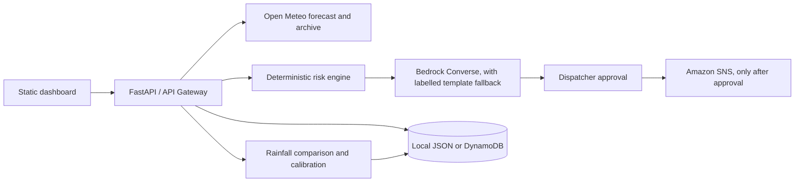

# Underpass Sentinel

An AI assisted decision support prototype for transport coordinators assessing rainfall related waterlogging risk at eight candidate low points in Delhi. It is designed for a dispatcher to review before any warning is distributed. It is **not** a certified flood prediction or emergency response system.

## Intended users and workflow

School transport coordinators, ambulance dispatchers, fleet operators, and other transport coordinators can use the six step workflow:

1. **Forecast:** request hourly precipitation from Open Meteo, or choose a clearly labelled historical Replay.
2. **Assess:** deterministic backend code compares the peak hourly precipitation with the current estimated threshold.
3. **Propose:** Bedrock Converse drafts an English and Hindi recommendation from those computed results. If Bedrock is unavailable or returns invalid content, a deterministic template is identified as a fallback.
4. **Approve:** a dispatcher explicitly approves or rejects the proposal.
5. **Act:** approved text is sent to SNS when configured; local mode records `local-skipped` and sends nothing.
6. **Verify:** archived rainfall is compared with the forecast and may adjust estimated thresholds. This verifies rainfall comparisons only, not flooding.



## Risk calculation and source limits

For each location, the backend takes the maximum usable hourly precipitation in the assessment window, then computes `peak mm/hr ÷ threshold mm/hr`. A ratio below 0.6 is GREEN, 0.6 through less than 1.0 is AMBER, and 1.0 or above is RED. Missing, malformed, non-finite, and negative inputs are excluded; if no usable values remain, the spot is marked unavailable. Rainfall intensity is a proxy for potential waterlogging, not a measurement of standing water or a confirmed flood.

The inputs in [`data/spots.json`](data/spots.json) are eight **unverified candidate coordinates and estimated thresholds**. Every location has `verified: false`; thresholds are demonstration inputs between 8 and 25 mm/hr and are not official values. Coordinates and thresholds require independent field and engineering verification. Mutable calibration values are stored separately from those original inputs.

All precipitation values are in millimetres per hour. The official [Historical Forecast API](https://open-meteo.com/en/docs/historical-forecast-api) documents historical forecast coverage starting around 2021, with model coverage varying by date; its endpoint is `/v1/forecast` on the `historical-forecast-api.open-meteo.com` host. The official [Historical Weather API](https://open-meteo.com/en/docs/historical-weather-api) documents `/v1/archive`, ISO date parameters, timezone handling, and precipitation as the preceding-hour sum in mm. Times returned by Open Meteo use `Asia/Kolkata` local time. Live mode includes the current local hour, floored to the hour, plus the next 11 hourly timestamps (12 inclusive); precipitation at each timestamp is the provider's preceding-hour sum. Replay uses 00:00 through 11:00 inclusive on the selected date. Replay requests the Historical Forecast API for forecast precipitation and Archive API for observed precipitation. If historical forecast data is unavailable but archive data exists, the archive is labelled as a **forecast demonstration fallback**; it is not represented as the forecast a dispatcher would have seen at the time. Archive observations remain a separate series for verification. If providers return no usable rainfall, the interface offers a separate synthetic fixture, clearly labelled; it is never presented as live or historical weather.

Every threshold adjustment uses a rainfall classification: flagged plus observed peak at least 0.6x threshold is `true_alarm`; flagged below 0.6x is `false_alarm`; unflagged at or above threshold is `missed_event`. A false alarm raises the threshold by 5%; a missed event lowers it by 10%; changes are clamped to 0.5x–2x the original. `no_data` remains pending. No flood observations or flood ground truth are included in this prototype.

## Services and deployment architecture

- **FastAPI / Mangum:** JSON endpoints and Lambda adapter. `/api/health` gives safe readiness indicators. `/docs` provides OpenAPI documentation.
- **Open Meteo:** public live forecast, historical forecast, and archived precipitation endpoints; no API key is required. Requests are bounded by timeouts and location concurrency limits.
- **Amazon Bedrock:** `bedrock-runtime` Converse API receives structured, calculated assessment data. `BEDROCK_MODEL_ID` and `BEDROCK_REGION` configure access. `amazon.nova-lite-v1:0` is the default identifier; availability and model access vary by account and region. Invalid output or service errors produce `generated_by: fallback` plus a diagnostic reason.
- **Amazon DynamoDB:** proposals, independently calibrated thresholds, and verification history when `USE_DYNAMODB=true`. Local mode stores JSON under `.local_data/` and survives restarts. A configured DynamoDB permission or setup error fails clearly; it does not switch to local mode.
- **Amazon SNS:** sends the bilingual alert only after dispatcher approval. Without `SNS_TOPIC_ARN`, approval is recorded as `local-skipped`. Email subscription requires recipient confirmation by SNS before delivery.
- **API Gateway HTTP API / SAM:** publishes the Lambda API with CORS origins configured as an exact list. CORS is not an authentication mechanism; deploy this decision support prototype only within an appropriate access-controlled environment.
- **Amplify Hosting:** serves a reproducible static ZIP created by `scripts/package_frontend.sh`. Leaflet and CARTO tiles, Google Fonts, and the map tiles are external browser dependencies and require network availability and attribution.

## Local setup

Requires Python 3.12 or newer (the SAM Lambda runtime is Python 3.12) and a network connection for live or historical Open Meteo data. Local Replay and the labelled synthetic fixture do not require AWS credentials.

```sh
python -m venv .venv
# Linux/macOS:
. .venv/bin/activate
# Windows PowerShell: .venv\Scripts\Activate.ps1
python -m pip install -r backend/requirements.txt
cp .env.example .env
python -m uvicorn backend.app.main:app --host 127.0.0.1 --port 8000
```

Open <http://127.0.0.1:8000>. The backend also serves the static dashboard, so requests use the same origin. Choose Replay and a past date, run an assessment, review the source badge and proposal, then approve or reject. Without SNS, the delivery result must say `local-skipped`. Historical rainfall can be verified after a Replay. Review the History tab for source, threshold changes, and rainfall-only caveats. If Open Meteo cannot provide values, the separate synthetic option proves the assessment/proposal/approval workflow. Synthetic forecasts cannot be verified or used for threshold calibration; use a historical forecast assessment instead.

For shell-based startup on Linux/macOS/Git Bash, use `sh scripts/run_local.sh`. API docs are at <http://127.0.0.1:8000/docs>; health is at <http://127.0.0.1:8000/api/health>.

## Tests

Run `python -m pytest -q`. Tests cover risk boundaries and invalid values, calibration bounds and outcome classification, proposal consistency, candidate inputs, API input validation, local persistence across storage recreation, and approval/rejection with local skipped delivery. External services are stubbed for the test suite; passing tests do not prove AWS, Bedrock, SNS, or Open Meteo availability.

**Execution in this workspace (2026-10-11):** 22 tests passed, 0 failed; `node --check frontend/app.js` and Python compilation passed; the reproducible frontend ZIP was generated twice with matching SHA-256. A live local server returned HTTP 200 for the dashboard and API. A real Replay for 2025-05-01 returned rainfall data for all eight candidate spots, completed a fallback proposal, recorded approval as `local-skipped`, and produced eight rainfall-based `no_event` history records from archived observations. Bedrock fell back because the AWS security token was rejected; no SNS topic was configured. SAM CLI and browser automation were unavailable, so `sam build` and a 390px viewport inspection were not run. Git metadata is not present in this workspace, and Git refuses the parent home-directory metadata because of its ownership boundary, so no commit was created.

## AWS SAM deployment

1. Install AWS SAM CLI and configure AWS credentials for the target account.
2. Check the model identifier and region against the model access available to your account. Request/enable access to Amazon Nova Lite in that Bedrock region, then set `BedrockModelId` and `BedrockRegion` during deploy. The default model identifier may not be available in every region/account.
3. Build and deploy from the repository root:

   ```sh
   sam build
   sam deploy --guided
   ```

4. Set `FrontendOrigins` to the exact Amplify website origin (scheme and host, no path) so API Gateway CORS permits that browser origin.
5. Copy the `ApiUrl` stack output into `frontend/config.js` as `apiBaseUrl` (for example `https://…execute-api.…amazonaws.com`). Rebuild the static archive after editing.
6. Run `sh scripts/package_frontend.sh`; upload `dist/underpass-sentinel-frontend.zip` using Amplify Hosting's manual deployment flow.
7. The stack creates an SNS topic. Subscribe an email with the dashboard or SNS console and click the confirmation link sent to that mailbox. An unconfirmed subscription will not receive notifications.
8. Review Lambda role permissions, model availability, API CORS, and the deployed `/api/health` response. A successful SAM build is not an AWS deployment or integration test.

The frontend contains no AWS credentials. Do not put credentials in `frontend/config.js`.

## Three minute demo script

1. Open the dashboard and point out the candidate locations and unverified threshold disclaimer.
2. Select **Replay**, choose a completed date, and run an assessment. Explain that historical forecast and archived observed rainfall are distinct sources.
3. Show the source and risk labels, open a spot marker, and inspect its estimated threshold and peak precipitation.
4. Review the English and Hindi proposal, risk reasoning, and generation badge. If Bedrock access is absent, explain that the clearly marked deterministic fallback is active.
5. Reject a proposal to show that rejected warnings cannot publish; create another proposal and explicitly approve it. In local mode, show `local-skipped`, not a delivered notification.
6. Verify a Replay proposal and open History. Explain that results classify rainfall comparisons only; this demo has no flood observation labels.

## Assumptions and limitations

- The eight locations, their coordinates, thresholds, and generic route review prompts are unverified demo inputs. No alternative route is asserted safe.
- Historical forecast data is not a record of what a dispatcher actually received at the historical time. Archive fallback is labelled as such.
- Open Meteo availability, coverage, map tiles, fonts, internet connectivity, Bedrock model access, SNS subscriptions, and AWS permissions are external dependencies.
- The prototype does not authenticate dispatcher users, measure on-road conditions, ingest official closures, or establish hydraulic flood depth or ground truth.
- For a local demo without provider connectivity, use the explicit synthetic option. Synthetic and archive demonstration forecasts cannot be verified or used to calibrate thresholds; use a historical forecast assessment instead.
- Local JSON storage is intended for a single local demo process, not concurrent production use.

## AI Coding Tools Used

Antigravity.

## License

MIT. See [LICENSE](LICENSE).
