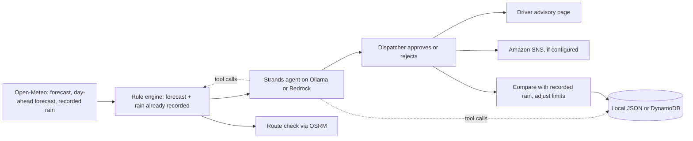

# Underpass Sentinel

Decision support for the people who dispatch school buses, ambulances and delivery fleets in Delhi during the monsoon. It watches 26 candidate low points (underpasses and low-lying roads), flags the ones where rain is forecast or already falling hard, has an AI agent draft the alert, and keeps a human dispatcher in charge of sending it.

It is a prototype. It is **not** a certified flood prediction or emergency response system.

Built for Environmental Hacks (WeMakeDevs with AWS), **Heat and Water** track, on the **Build It** path: the alert is drafted by an agent built with the open-source [Strands Agents SDK](https://strandsagents.com) from AWS, running on a local Ollama model. No AWS account is needed to run it. The same code can be deployed to AWS with the included SAM template.

## The problem

Every monsoon the same Delhi underpasses fill with water within an hour of heavy rain. Vehicles are routed into them because the dispatcher has a city-wide forecast, not an answer for one road. On 31 July 2024 the weather record for one of these spots shows 85.7 mm of rain in an hour; the forecast issued the day before showed 2 mm/hr.

## What it does

1. **Assess.** For each low point, two signals are compared with that spot's own limit (threshold):
   - the rain **forecast** for the hours ahead, and
   - rain **already recorded** in the last three hours.

   The higher of the two sets the level: LOW under 60% of the limit, WATCH from 60% to under 100%, HIGH at or above it. A spot flagged by recorded rain is marked "RAIN NOW".
2. **Propose.** A Strands agent reads the computed assessment through tools and drafts the briefing and one action per spot. Numbers, risk levels and the Hindi text always come from the rule engine.
3. **Approve.** A dispatcher approves or rejects. Nothing is published before that.
4. **Act.** An approved alert appears on the **driver advisory page** (`/advisory.html`), a phone-first page in Hindi and English. With SNS configured it is also emailed.
5. **Check a route.** Pick an origin and destination; driving alternatives are scored by the flagged spots they pass.
6. **Verify.** For a replayed day, the forecast is compared with the rain later recorded, and each spot's limit adjusts after false alarms and misses.



## Why two signals: the backtest

`python scripts/backtest.py` compares the day-ahead forecast with recorded rain for all 26 spots over the 2024 and 2025 monsoons (15 June to 30 September, 216 days, 5,616 spot-days). The result is stored in [`data/backtest.json`](data/backtest.json) and shown in the app's Track record tab:

| Measure | Count |
|---|---|
| Heavy-rain events (recorded peak at or above the spot's limit) | 102 |
| Flagged in advance by the day-ahead forecast | 24 (24%) |
| Missed by the day-ahead forecast | 78 |
| Forecast flags raised | 160 |
| Of those, false alarms (recorded peak under 60% of the limit) | 102 |

A day-ahead forecast alone misses about three in four of these events, and most of the flags it raises are false alarms. That is why the app also flags on rain already recorded: it reacts within the hour rather than predicting, but it does not miss a downpour that is happening. Only 9 of the 78 missed events had watch-level rain in an earlier hour, so this second signal gives little advance warning. It is a safety net, not a forecast.

Read these numbers with their limits: "recorded rain" is a weather-model analysis from Open-Meteo's archive, not a rain gauge; the limits are unverified estimates; and nothing here measures flooding.

## Data sources and what "replay" means

- **Live.** One batched request to the Open-Meteo forecast API. The window is the current hour plus the next 11. The three hours before now, from the same response, are the recorded-rain signal.
- **Replay.** Pick a past date and an "as of" hour. The forecast is the **day-ahead forecast** from Open-Meteo's Previous Runs API (`precipitation_previous_day1`: what was predicted one day earlier), available from 2024. Recorded rain comes from the Archive API. The window runs from the "as of" hour to 23:00, and the three hours before it are the recorded-rain signal.
- **Before 2024** there is no day-ahead forecast. Open-Meteo's Historical Forecast API returns the same series as the archive for those dates, so the app labels it a stand-in and refuses to verify it, since that would compare a series with itself.
- **Storm drill.** A synthetic fixture, labelled as such everywhere, for showing HIGH-risk behaviour. It cannot be verified.

All times are Asia/Kolkata. Precipitation is millimetres in the preceding hour. Missing or malformed values are excluded, never treated as dry.

The 26 locations in [`data/spots.json`](data/spots.json) are **unverified candidate coordinates and estimated limits** (10 to 22 mm/hr). Every one has `verified: false`. They need field and engineering verification before any real use.

Verification classifies each spot: flagged and recorded peak at least 60% of the limit is `true_alarm`; flagged and below that is `false_alarm`; not flagged but at or above the limit is `missed_event`. A false alarm raises the limit 5%, a miss lowers it 10%, clamped to 0.5x to 2x the original.

## The agent

[`backend/app/services/agent.py`](backend/app/services/agent.py) defines the Strands agent and its tools, `get_flagged_spots` and `get_calibration_history`. Guardrails:

- The agent writes prose only. Every number, level, spot id and timestamp in the stored alert is copied from the computed assessment and validated.
- A reply written without calling `get_flagged_spots` is rejected.
- Text that claims flooding, water on the road, or that a route is safe is discarded and replaced with a computed sentence, because rainfall is the only input.
- The Hindi text is a fixed template; small local models do not write reliable Hindi.
- The model sees only the five worst spots; the full lists are added by code.
- Any failure falls back to a template, labelled as such, with the reason shown.

Each alert stores an `agent_trace` (framework, provider, model, tools called) that the dashboard displays. `AGENT_PROVIDER=ollama` (default) uses a local model; `AGENT_PROVIDER=bedrock` runs the same agent on Amazon Bedrock.

## Route check and 3D view

- **Route check** ([`routing.py`](backend/app/services/routing.py)) asks the public OSRM servers (OpenStreetMap data) for driving alternatives and scores each by flagged spots within 300 m (HIGH 10, WATCH 3). "Clear of flagged spots" is not a claim that a road is dry.
- **3D view** ([`scene3d.js`](frontend/scene3d.js), Three.js): one pillar per low point, height showing rain as a share of that spot's limit, with a ring at the limit.

## Run it locally

Requires Python 3.12 or newer and internet access for weather, maps and routing.

```sh
python -m venv .venv
# Linux/macOS:  . .venv/bin/activate
# Windows:      .venv\Scripts\Activate.ps1
python -m pip install -r backend/requirements.txt
cp .env.example .env
python -m uvicorn backend.app.main:app --host 127.0.0.1 --port 8000
```

Open <http://127.0.0.1:8000>. If port 8000 is in use, pick another and set `CORS_ORIGINS` to match.

For agent-drafted alerts, install [Ollama](https://ollama.com), start it, and pull a tool-capable model (`ollama pull qwen3-vl:2b-instruct`, or set `OLLAMA_MODEL_ID`). Without Ollama the app still works and labels alerts as template text. Nothing in local mode needs AWS credentials.

## Three minute demo

1. Open the page. The hero states the problem; scroll to the dashboard.
2. Click **Replay**, then **31 Jul 2024, 6 am · forecast missed**. Nothing is flagged: this is what the forecast said that morning.
3. Click **31 Jul 2024, 8 pm · cloudburst**. Every spot turns HIGH with a "RAIN NOW" tag: the second signal caught what the forecast missed. Show the **AI AGENT DRAFT** badge and the tools the agent called, then the Hindi tab.
4. Toggle **3D view**.
5. Click **Approve and send**, then open **Driver view**: the alert on a phone-sized page, in Hindi.
6. Click **1 Aug 2024 · forecast held**, open **Route check**, and check a trip.
7. Approve it, click **Check against recorded rain**, and open **Track record**: real outcomes for that day, plus the two-season backtest that explains why both signals exist.

## Tests

`python -m pytest -q` runs 33 tests covering the risk rules, the recorded-rain trigger, replay source selection, batched weather requests, agent reply parsing and guardrails, the Hindi summary, calibration, route scoring, storage, approval and rejection, and the driver advisory. External services are stubbed, so passing tests do not prove Open-Meteo, Ollama, OSRM or AWS are available.

**What was actually run (2026-10-11):**

- 33 tests passed.
- `scripts/backtest.py` ran against the live Open-Meteo APIs and produced the numbers above.
- A scripted click-through in headless Chrome, against a live local server with real weather data and the Strands agent on Ollama (`qwen3-vl:2b-instruct`), passed 14 steps with no console errors: hero replay of the cloudburst, language switch, day-ahead replay, route check, approve, verify, track record, reject, 3D view with drag, live assessment, table filter, driver advisory in both languages, and a 390 px phone layout with no sideways scroll.
- Not run: `sam build`, any AWS deployment, the Bedrock provider (the local AWS credentials were rejected), SNS delivery, and DynamoDB storage.

## Deploying to AWS (untested)

[`template.yaml`](template.yaml) defines a Lambda (FastAPI via Mangum) behind an API Gateway HTTP API, three DynamoDB tables, and an SNS topic, with `AGENT_PROVIDER=bedrock`.

1. Install the AWS SAM CLI and configure credentials.
2. Enable access to the Bedrock model you choose in your region, then `sam build` and `sam deploy --guided`, setting `BedrockModelId`, `BedrockRegion` and `FrontendOrigins`.
3. Put the `ApiUrl` output in `frontend/config.js`, run `sh scripts/package_frontend.sh`, and upload the ZIP to Amplify Hosting.
4. Subscribe an email to the SNS topic and confirm it.

This path has not been built or deployed from this workspace. The frontend holds no credentials. The API has no authentication, so deploy it only inside an access-controlled environment.

## Limitations

- Rainfall is a proxy. The app never observes water on a road, and has no flood ground truth.
- Locations, coordinates and limits are unverified estimates.
- The day-ahead forecast misses most heavy-rain events (see the backtest). The recorded-rain signal is reactive and is itself a model analysis, not a gauge.
- A small local model writes plain and sometimes imprecise prose. Its reasoning is shown as an "Agent note" after the computed reasoning, and it never controls numbers, levels, flagged locations or Hindi text.
- The Hindi wording was written for this prototype and has not been reviewed by a native-speaking editor.
- Route check depends on the public OSRM demo servers, uses approximate place coordinates, ignores traffic, and measures straight-line distance from a route to a spot.
- There is no user login. Anyone who can reach the app can approve an alert.
- Local JSON storage is for a single demo process.
- Map tiles, fonts, Three.js, Open-Meteo, OSRM and Ollama are external dependencies.

## AI Coding Tools Used

Antigravity.

## Credits

Hero photo: "Delhi, India, Rain, Street at night" by Vyacheslav Argenberg, [CC BY 4.0](https://creativecommons.org/licenses/by/4.0/), via Wikimedia Commons, resized. Map data and routing: OpenStreetMap contributors and OSRM. Weather: Open-Meteo.

## License

MIT. See [LICENSE](LICENSE).
